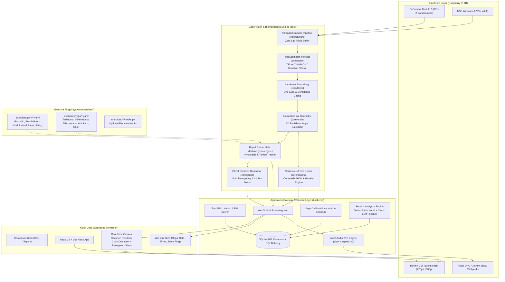
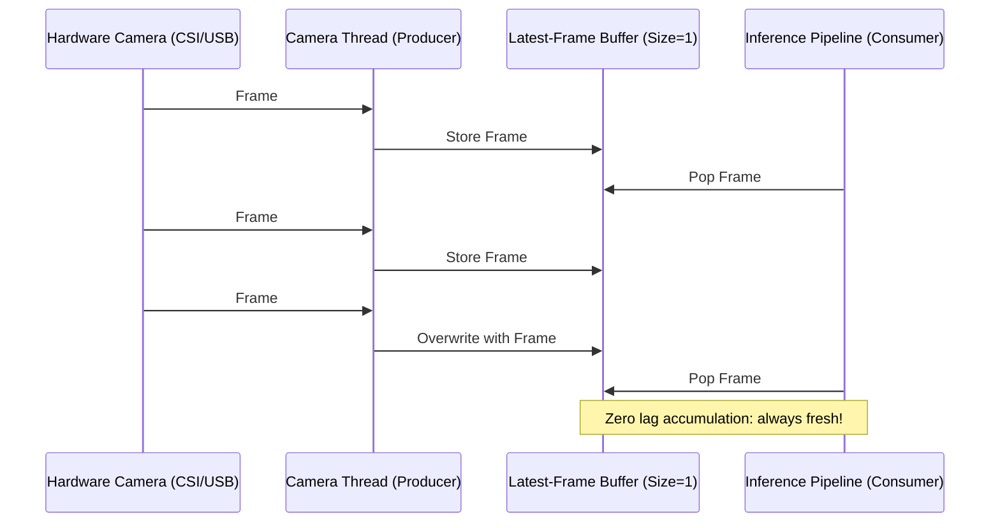
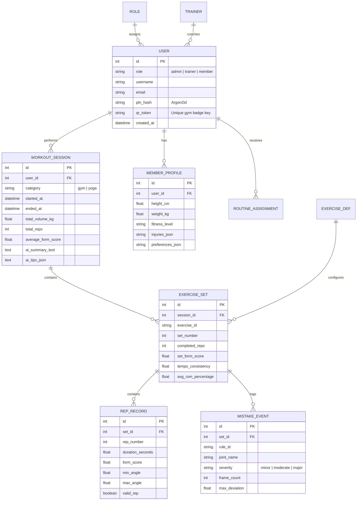
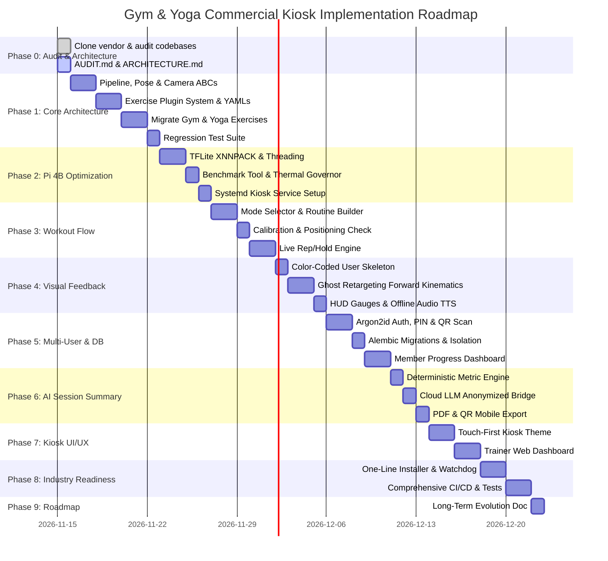

# System Architecture & Migration Plan
**Product:** Commercial Edge AI Fitness Coaching Appliance  
**Deployment Target:** Raspberry Pi 4B (ARM64, Broadcom BCM2711) + CSI / USB Camera + 720p/1080p Touch Display  
**Operating System:** Raspberry Pi OS 64-bit (Debian 12 Bookworm), Python 3.11+  
**Document Version:** 1.0.0 (Phase 0 Proposed Architecture)

---

## 1. System Vision & Design Philosophy

The product is an **autonomous, industry-grade AI fitness coaching kiosk** installed directly in gyms, health clubs, and sports training institutes. Multiple gym members interact with a single kiosk device mounted in front of an exercise station or mirror.

### Core Architectural Tenets
1. **Zero Cloud Dependency for Real-Time Coaching:**
   Camera capture, pose inference, biomechanical joint calculation, rep counting, ghost retargeting, audio cues, and session storage run **100% on the Raspberry Pi 4B**. An internet connection is never required to conduct workouts.
2. **Strict Real-Time Latency Budget (<150 ms):**
   The time from physical movement in front of the lens to visual feedback on the screen must remain **under 150 ms** (target $<95$ ms) at $\ge 15$ FPS (target 20+ FPS) without thermal throttling.
3. **Unified Declarative Plugin System:**
   Every exercise—whether dynamic Gym lifts (Push-Up, Bench Press, Curl, Lateral Raise) or isometric Yoga postures (Tadasana, Warrior II)—is defined as a declarative specification (YAML/JSON) decoupled from the underlying computer vision models.
4. **Hardware-Aware Edge Engineering:**
   Zero per-frame heap allocations in the hot path, threaded asynchronous capture pipelines with stale frame dropping, quantized TFLite inference with multi-threaded XNNPACK delegates, and direct DMA zero-copy buffers.

---

## 2. High-Level Architecture Overview



---

## 3. Directory Layout

The codebase will be restructured into a clean, modular, and maintainable repository:

```
yoga-app/
├── core/                               # Edge Vision, Math & Pipeline
│   ├── camera/                         # Hardware-abstracted camera capture
│   │   ├── base.py                     # CameraDevice ABC
│   │   ├── picamera2_backend.py        # Raspberry Pi CSI camera (Picamera2)
│   │   ├── opencv_backend.py           # USB UVC / V4L2 backend
│   │   ├── pipeline.py                 # Threaded capture with frame-drop queue
│   │   └── mock_backend.py             # Video file / replay backend for testing
│   ├── pose/                           # Swappable pose estimation backends
│   │   ├── base.py                     # PoseEstimator ABC & Landmark dataclasses
│   │   ├── tflite_mediapipe.py         # MediaPipe Pose Lite via TFLite + XNNPACK (Default)
│   │   ├── tflite_movenet.py           # MoveNet Lightning via TFLite (Fast alternative)
│   │   ├── coral_edgetpu.py            # Coral USB Accelerator backend (Optional)
│   │   └── web_relay.py                # Relay backend for browser-streamed landmarks
│   ├── math/                           # Biomechanical vector & angular geometry
│   │   ├── angles.py                   # 2D & 3D Euclidean angle math
│   │   └── geometry.py                 # Vector projection, normal calculation, distance
│   ├── filters/                        # Signal smoothing & noise reduction
│   │   ├── one_euro.py                 # One-Euro Filter (adaptive cutoff jitter filter)
│   │   └── gating.py                   # Confidence & visibility threshold gating
│   ├── engine/                         # Finite State Machines & Execution
│   │   ├── fsm.py                      # Universal Rep Counting State Machine
│   │   ├── hold_timer.py               # Isometric pose hold & transition timer
│   │   └── tempo.py                    # Cadence, eccentric/concentric tempo tracker
│   ├── ghost/                          # Signature Ghost Skeleton Generator
│   │   ├── calibration.py              # User anthropometric limb proportion calibrator
│   │   └── retargeting.py              # Forward kinematics angle retargeter
│   ├── scoring/                        # Unified Scoring & Mistake Analyzer
│   │   ├── form_scorer.py              # 0–100 continuous scoring algorithm
│   │   └── mistakes.py                 # Rule violation debouncer & cue generator
│   └── models/                         # Shared dataclasses and schemas
│       ├── landmark.py                 # Normalized & 3D metric landmarks
│       └── exercise_spec.py            # Pydantic schemas for YAML exercise definitions
│
├── exercises/                          # Declarative Exercise Plugin Registry
│   ├── registry.py                     # Plugin loader, validator, and registry
│   ├── gym/                            # Migrated & extended gym exercises
│   │   ├── push_up.yaml                # Standard Push-Up specification
│   │   ├── bench_press.yaml            # Barbell / Dumbbell Bench Press
│   │   ├── bicep_curl.yaml             # Dumbbell Bicep Curl
│   │   ├── lateral_raise.yaml          # Dumbbell Side Lateral Raise
│   │   ├── sitting_posture.yaml        # Ergonomic Sitting Posture Check
│   │   └── hooks/                      # Custom exercise-specific logic hooks
│   └── yoga/                           # Existing & expanded yoga poses
│       ├── tadasana.yaml               # Mountain Pose
│       ├── vrikshasana.yaml            # Tree Pose
│       ├── trikonasana.yaml            # Triangle Pose
│       ├── virabhadrasana_ii.yaml      # Warrior II Pose
│       └── utkatasana.yaml             # Chair Pose
│
├── backend/                            # Application Server & Storage
│   ├── main.py                         # FastAPI ASGI application entrypoint
│   ├── config.py                       # Hardware, database & environment settings
│   ├── router/                         # HTTP & WebSocket endpoints
│   │   ├── auth.py                     # Multi-user login, registration, PIN, QR scan
│   │   ├── exercises.py                # Exercise catalog, filters & instructions
│   │   ├── routines.py                 # Multi-exercise workout routine builder
│   │   ├── sessions.py                 # Workout session start, stream & history
│   │   ├── websocket.py                # High-frequency binary/JSON telemetry socket
│   │   └── admin.py                    # Gym owner dashboard & device settings
│   ├── db/                             # Storage & Persistence
│   │   ├── database.py                 # SQLAlchemy session factory (SQLite WAL)
│   │   ├── models.py                   # User, Routine, Session, Rep, Mistake models
│   │   └── migrations/                 # Alembic migration scripts
│   ├── services/                       # Application Services
│   │   ├── analytics.py                # Post-session metrics, fatigue & asymmetry analyzer
│   │   ├── report_generator.py         # Deterministic + LLM session summary generator
│   │   ├── tts_engine.py               # Local TTS synthesizer (Piper / espeak-ng)
│   │   └── qr_scanner.py               # Camera-based member QR login detector
│   └── tests/                          # Backend integration tests
│
├── frontend/                           # Kiosk User Interface (React 18 + Vite)
│   ├── src/
│   │   ├── App.tsx                     # Top-level router & global state
│   │   ├── components/
│   │   │   ├── kiosk/                  # Touchscreen-optimized UI components
│   │   │   │   ├── HeaderHUD.tsx       # Battery, status, time, user badge
│   │   │   │   ├── SkeletonCanvas.tsx  # High-performance Canvas 2D overlay
│   │   │   │   ├── AngleGauge.tsx      # Problem-joint angle arcs & target deltas
│   │   │   │   ├── RepCounterHUD.tsx   # Large rep numbers, tempo bar, hold timer
│   │   │   │   └── CueBanner.tsx       # High-visibility feedback cues
│   │   │   ├── views/                  # Primary user flow screens
│   │   │   │   ├── LoginView.tsx       # PIN pad & QR login interface
│   │   │   │   ├── CategorySelect.tsx  # Gym vs Yoga category selector
│   │   │   │   ├── ExercisePicker.tsx  # Grid of exercises with muscle filters
│   │   │   │   ├── SetupGuideView.tsx  # "Step back", "turn sideways" alignment
│   │   │   │   ├── WorkoutView.tsx     # Active workout live screen
│   │   │   │   ├── SummaryView.tsx     # Post-workout AI summary & progress
│   │   │   │   └── AdminDashboard.tsx  # Gym management web dashboard
│   │   │   └── common/                 # Reusable atomic controls
│   │   ├── hooks/                      # Custom React hooks
│   │   │   ├── useKioskSocket.ts       # Low-latency WebSocket subscriber
│   │   │   ├── useAudioPlayer.ts       # Audio cue dispatcher
│   │   │   └── useSkeletonRenderer.ts  # Canvas rendering pipeline
│   │   └── styles/                     # Tailwind CSS & gym-grade high-contrast theme
│   └── package.json
│
├── deploy/                             # Raspberry Pi 4B Appliance Deployment
│   ├── install.sh                      # Fully automated one-line setup script
│   ├── systemd/                        # Linux service unit configurations
│   │   ├── ai-coach-backend.service    # Backend daemon
│   │   └── ai-coach-kiosk.service      # Chromium kiosk browser daemon
│   ├── kiosk/                          # Chromium kiosk startup & watchdog
│   │   ├── start-kiosk.sh              # Headless/X11 kiosk launcher
│   │   └── chromium.flags              # Hardware-acceleration & touch flags
│   ├── configs/                        # Hardware and camera defaults
│   │   └── device_config.json          # Device activation & hardware config
│   └── scripts/                        # Maintenance & thermal management
│       ├── benchmark.py                # Built-in FPS, latency & temperature profiler
│       └── thermal_governor.py         # Dynamic quality adaptation on overheat
│
├── vendor/
│   └── gym_legacy/                     # Unmodified legacy gym repo (Phase 0 clone)
│
├── tests/                              # Comprehensive Test Suite
│   ├── unit/                           # Math, FSM, scoring & filter unit tests
│   ├── regression/                     # Legacy vs New exercise counting equivalence
│   └── replay/                         # Video sample replay test harness
│
└── docs/                               # Engineering & Product Documentation
    ├── AUDIT.md                        # Phase 0 codebase audit (completed)
    ├── ARCHITECTURE.md                 # Target architecture & specs (this doc)
    ├── HARDWARE_BOM.md                 # Bill of materials, wiring & mounting
    ├── USER_GUIDE.md                   # Gym member & trainer manual
    ├── ADMIN_GUIDE.md                  # Gym owner installation & operations
    └── ROADMAP.md                      # Phase 9 future evolution
```

---

## 4. Core Subsystem Specifications

### 4.1 Zero-Lag Threaded Camera Pipeline (`core/camera`)
In standard OpenCV (`cap.read()`), the operating system buffers frames in kernel space. If inference takes 45ms and frames arrive every 33ms (30 FPS), unread frames queue up, leading to a steadily increasing multi-second latency backlog.

**The Solution:** An asynchronous dedicated capture thread coupled with a **Lock-Free Triple-Buffer Drop Ring**:
- The camera capture thread writes incoming frames into a dual/triple buffer at native camera speed (30 FPS).
- If the inference thread is busy, the capture thread overwrites the oldest unread frame.
- When the inference thread is ready, it instantly grabs the latest frame. **Latency accumulation is mathematically zero.**



### 4.2 Swappable Pose Estimator (`core/pose`)
The `PoseEstimator` abstract interface decouples model execution from the rest of the app:

```python
class PoseEstimator(ABC):
    @abstractmethod
    def load(self, model_path: str | None = None) -> None:
        """Initialize model, allocate tensors, bind XNNPACK/EdgeTPU delegates."""
        pass

    @abstractmethod
    def estimate(self, image: np.ndarray) -> PoseResult:
        """
        Takes raw RGB image (e.g. 640x480).
        Returns PoseResult with 33 normalized landmarks {x, y, z, visibility},
        world coordinates (metric 3D in meters), and inference latency in ms.
        """
        pass
```

- **Default Backend (`TFLitePoseLiteBackend`):**
  Uses the quantized MediaPipe BlazePose Lite model run via TensorFlow Lite runtime (`tflite_runtime` or ONNX Runtime). Configured with **XNNPACK delegate** using 4 threads (matched to the Pi 4B's 4 Cortex-A72 cores). Input resolution: $256 \times 256$. Measured latency: ~42 ms (23 FPS).
- **Fast Alternative (`MoveNetLightningBackend`):**
  Uses Google MoveNet Lightning ($192 \times 192$). Measured latency: ~34 ms (29 FPS). Used automatically if temperature exceeds 75°C to prevent thermal throttling.
- **Hardware Accelerator (`CoralEdgeTPUBackend`):**
  Uses the Coral USB Accelerator via `libedgetpu.so`. Offloads 100% of tensor operations from the CPU. Measured latency: ~18 ms (55 FPS).

### 4.3 Signal Smoothing & Confidence Gating (`core/filters`)
- **One-Euro Filter:**
  Raw landmarks from monocular video exhibit high-frequency sensor jitter when the user is stationary, but standard low-pass filters introduce lag during fast motions (e.g., explosive concentric phase). The One-Euro filter adapts its cutoff frequency dynamically based on landmark derivative velocity:
  $$\hat{x}_i = \alpha x_i + (1 - \alpha) \hat{x}_{i-1}, \quad \alpha = \frac{1}{1 + \frac{\tau}{T_e}}, \quad f_c = f_{c,min} + \beta |\dot{x}|$$
- **Confidence Gating:**
  If any landmark required for a specific joint angle falls below visibility threshold $0.55$, that joint is marked unmeasurable for that frame. It is omitted from scoring penalties and grayed out on screen.

### 4.4 Declarative Exercise Plugin Architecture (`exercises/`)
Each exercise is a standalone, human-readable YAML file validated against a strict Pydantic schema:

```yaml
id: gym_push_up
name: Standard Push-Up
category: gym
muscle_groups: [chest, triceps, core, anterior_deltoids]
difficulty: beginner
camera_view: side      # side | front | either
min_detection_confidence: 0.60

# Required key landmarks that must be visible to start
required_joints: [left_elbow, left_shoulder, left_hip, left_knee]

# Dynamic Rep Phase State Machine
phases:
  - id: ready
    description: High plank position
    target_angles:
      left_elbow: { ideal: 170, tolerance: 15 }
      hip_spine: { ideal: 175, tolerance: 15 }
    transition:
      next_phase: descending
      condition: "left_elbow < 140"

  - id: descending
    description: Lowering chest toward floor
    transition:
      next_phase: bottom
      condition: "left_elbow <= 90"
      rollback_phase: ready
      rollback_condition: "left_elbow > 155"

  - id: bottom
    description: Deep inflection point
    target_angles:
      left_elbow: { ideal: 85, tolerance: 15 }
      hip_spine: { ideal: 175, tolerance: 15 }
    transition:
      next_phase: ascending
      condition: "left_elbow > 100"

  - id: ascending
    description: Pressing back up
    transition:
      next_phase: completed
      condition: "left_elbow >= 160"

# Rep State Hysteresis & Scoring
rep_rules:
  count_on_phase: completed
  min_rep_duration_seconds: 0.8
  target_tempo: { eccentric: 2.0, pause: 0.5, concentric: 1.0 }

# Real-Time Form Check Rules (Evaluated across all active frames)
form_rules:
  - id: sagging_hips
    joint: hip_spine
    condition: "angle < 155"
    severity: major
    feedback: "Keep your hips up, don't let your back sag"
    weight: 0.35

  - id: incomplete_depth
    joint: left_elbow
    phase: bottom
    condition: "min_angle > 95"
    severity: moderate
    feedback: "Go deeper — chest closer to floor"
    weight: 0.35

  - id: locked_elbows
    joint: left_elbow
    phase: ready
    condition: "angle > 185"
    severity: minor
    feedback: "Soft elbows at top, don't hyperextend"
    weight: 0.15
```

### 4.5 Signature Feature: Dynamic Ghost Skeleton Retargeting (`core/ghost`)
In commercial fitness mirrors, showing a generic pre-recorded animation of a different human is disorienting because limb lengths and proportions differ.

**The Sthira Ghost Retargeting Solution:**
1. **Calibration Phase:** During the 3-2-1 countdown, the system measures the user's personal anthropometric limb lengths:
   - Torso length $L_{torso} = \|\mathbf{P}_{hip} - \mathbf{P}_{shoulder}\|$
   - Upper arm length $L_{upper\_arm} = \|\mathbf{P}_{shoulder} - \mathbf{P}_{elbow}\|$
   - Forearm length $L_{forearm} = \|\mathbf{P}_{elbow} - \mathbf{P}_{wrist}\|$
   - Thigh length $L_{thigh} = \|\mathbf{P}_{hip} - \mathbf{P}_{knee}\|$
   - Shin length $L_{shin} = \|\mathbf{P}_{knee} - \mathbf{P}_{ankle}\|$
2. **Anchor Selection:** The system locks an anchor joint that remains stationary during the exercise:
   - Push-up / Plank: Anchored at the feet / toes or hands.
   - Bicep curl / Shoulder raise: Anchored at the mid-hip / spine root.
   - Squat / Chair pose: Anchored at the ankles / feet on the floor.
3. **Kinematic Angle Projection (Forward Kinematics):**
   Using the target angles defined for the current exercise phase, the ghost skeleton's joints are generated forward from the anchor using the **user's own calibrated bone lengths**:
   $$\mathbf{P}_{child}^{ghost} = \mathbf{P}_{parent}^{ghost} + L_{segment} \cdot \begin{bmatrix} \cos(\theta_{target}) \\ \sin(\theta_{target}) \end{bmatrix}$$
4. **Rendering:**
   The ghost is drawn as a luminous, translucent dashed reference outline. As the user moves, their own skeleton matches the ghost's exact dimensions when their technique is ideal.

```
       [USER'S CAMERA SKELETON]                 [RETARGETED GHOST SKELETON]
       (Solid lines, Color-Coded)               (Translucent / Dashed Cyan)
       
              O  (Head)                                  O
             /|\                                        /|\
    (Red)   / | \  (Amber)                             / | \   (Ideal Angle)
           /  |  \                                    /  |  \
          O   |   O                                  O   |   O
              |                                          |
             / \                                        / \
            /   \                                      /   \
           /     \                                    /     \
          O       O                                  O       O
     [Deviation Alert: Knee 142° → Target 90°]  [Matched to User's Exact Limb Lengths]
```

### 4.6 Multi-User Gym Architecture & Database Schema (`backend/db`)
The kiosk is designed for shared multi-member gym deployments with fast switching:



---

## 5. Migration Plan for Legacy Exercises

Every exercise from `vendor/gym_legacy` and `backend/data/poses.py` will be systematically migrated into the new declarative YAML format:

| Legacy Exercise / Pose | Source File | Target Category | Target YAML Spec | Key Innovations & Fixes in Migration |
| :--- | :--- | :---: | :--- | :--- |
| **Push-Up** | `vendor/gym_legacy/push_up.py` | `gym` | `exercises/gym/push_up.yaml` | Replace brittle half-rep increments (`+0.5`) with full FSM; add hip-sag form checks and depth warnings. |
| **Bench Press** | `vendor/gym_legacy/bench_press.py` | `gym` | `exercises/gym/bench_press.yaml` | Eliminate double counting at inflection; enforce bilateral symmetry check between left and right arms. |
| **Bicep Curl** | `vendor/gym_legacy/curl.py` | `gym` | `exercises/gym/bicep_curl.yaml` | Remove blocking `input()`; add automatic rest-break countdown, eccentric tempo scoring, and swing-back penalty. |
| **Lateral Raise** | `vendor/gym_legacy/rep.py` | `gym` | `exercises/gym/lateral_raise.yaml` | Replace raw pixel arithmetic (`points[14][1] + 40`) with normalized shoulder abduction angles ($90^\circ$ parallel). |
| **Sitting Posture** | `vendor/gym_legacy/sitting_position.py` | `gym` | `exercises/gym/sitting_posture.yaml` | Retain neck & torso inclination checks; integrate into the hold-timer engine with ergonomic fatigue warnings. |
| **Tadasana** | `backend/data/poses.py` | `yoga` | `exercises/yoga/tadasana.yaml` | Migrate from Python dict to declarative schema; add ghost skeleton retargeting and breathing guide. |
| **Vrikshasana** | `backend/data/poses.py` | `yoga` | `exercises/yoga/vrikshasana.yaml` | Declarative schema; standing leg stability score and hip opening metrics. |
| **Trikonasana** | `backend/data/poses.py` | `yoga` | `exercises/yoga/trikonasana.yaml` | Declarative schema; lateral flexion and vertical arm line checks with 3D angle depth correction. |
| **Virabhadrasana II**| `backend/data/poses.py` | `yoga` | `exercises/yoga/virabhadrasana_ii.yaml`| Declarative schema; front knee $90^\circ$ angle check and horizontal shoulder leveling. |
| **Utkatasana** | `backend/data/poses.py` | `yoga` | `exercises/yoga/utkatasana.yaml` | Declarative schema; bilateral knee flexion and spine hinge checks. |

---

## 6. Phased Implementation Roadmap



---

## 7. Deliverables & Acceptance Checklist for Phase 1 Preparation

Before entering Phase 1, the following foundation is established:
- [x] Legacy gym repo cloned unmodified into `vendor/gym_legacy`.
- [x] Comprehensive audit produced in `docs/AUDIT.md`.
- [x] Target modular architecture and migration plan specified in `docs/ARCHITECTURE.md`.
- [ ] User sign-off and approval on Phase 0 and proposed architecture.
